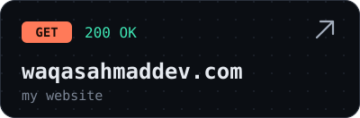
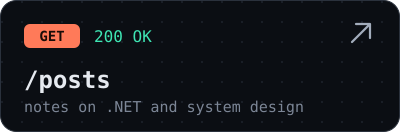
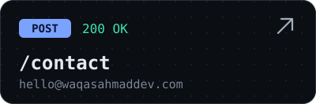

<a href="https://waqasahmaddev.com">
  
</a>

<p align="center">
  <a href="https://waqasahmaddev.com"></a>
  <a href="https://waqasahmaddev.com/posts/"></a>
  <a href="mailto:hello@waqasahmaddev.com"></a>
</p>

### Hey, I'm Waqas 👋

I'm a full stack software engineer with 10+ years of experience, mostly in .NET. I build backend systems, web apps and APIs, and I love system design. I also write about system design and AI.

My website is built like an API, so this page is too. Each section below is an endpoint.

### `GET /waqas`

```json
{
  "name": "Waqas Ahmad",
  "role": "Software Engineer",
  "experience": "10+ years, mostly .NET",
  "works_with": ["C#", ".NET", "ASP.NET Core", "SQL Server", "PostgreSQL", "JavaScript"],
  "loves": ["system design", ".NET", "small useful tools"],
  "writes_about": ["system design", "AI"],
  "links": {
    "website": "https://waqasahmaddev.com",
    "linkedin": "https://www.linkedin.com/in/waqas-ahmad62"
  }
}
```

### `GET /projects`

Small, focused open-source tools. Fast, light and friendly to the keyboard.

| Project | What it is | Language |
|---|---|---|
| **[snapricot](https://github.com/waqasahmaddev/snapricot)** · [site](https://waqasahmaddev.github.io/snapricot/) | A fast, open-source screenshot tool for Windows | C# |
| **[flow-select](https://github.com/waqasahmaddev/flow-select)** · [site](https://waqasahmaddev.github.io/flow-select/) | A fast, keyboard-first select for plain HTML forms. No dependencies | JavaScript |
| **[flow-datepicker](https://github.com/waqasahmaddev/flow-datepicker)** · [site](https://waqasahmaddev.github.io/flow-datepicker/) | A light, keyboard-first date, time and range picker. No dependencies | JavaScript |

### `GET /posts?limit=3`

<!-- POSTS:START -->
- **[I built my portfolio as an API](https://waqasahmaddev.com/posts/i-built-my-portfolio-as-an-api/)**  
  <sub>2026-10-18 · 2 min read</sub>
- **[Designing a small API in .NET, the boring way](https://waqasahmaddev.com/posts/designing-a-small-api-in-dotnet/)**  
  <sub>2026-10-17 · 3 min read</sub>
- **[Five things I check in a .NET code review](https://waqasahmaddev.com/posts/five-things-i-check-in-a-dotnet-code-review/)**  
  <sub>2026-10-16 · 3 min read</sub>
<!-- POSTS:END -->

This list updates itself every day from my own API.

### `POST /contact`

Have a role, a project or a hard problem? Send the request: [hello@waqasahmaddev.com](mailto:hello@waqasahmaddev.com) or find me on [LinkedIn](https://www.linkedin.com/in/waqas-ahmad62).

---

<sub>Try it yourself: <code>curl https://waqasahmaddev.com/api/waqas</code></sub>
